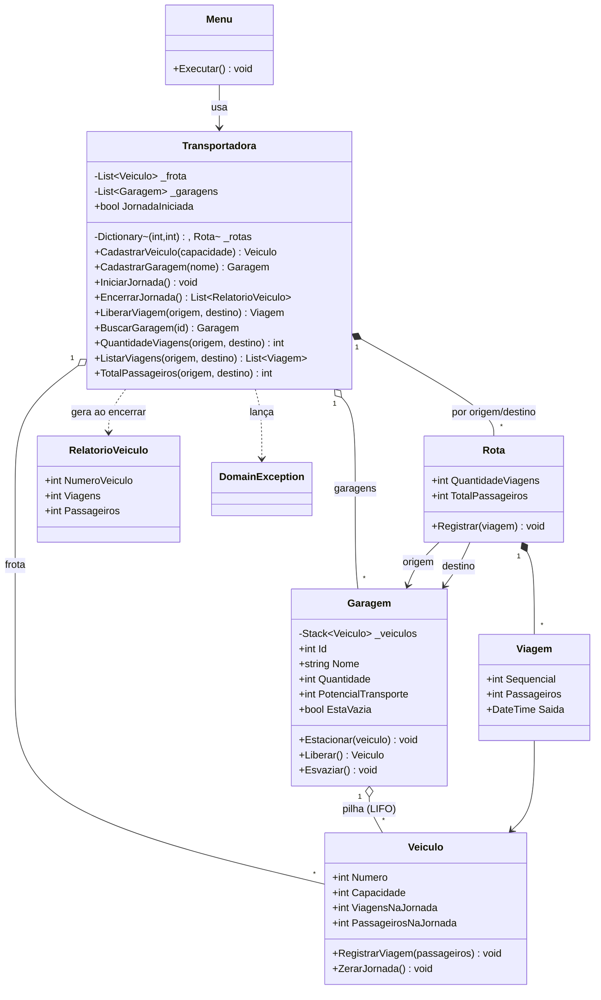

# Projeto Transporte — Controle de Frota (Console Application)

Aplicação de console em C# (.NET 8) que controla o fluxo de vans de uma empresa de fretamento entre garagens de aeroportos (inicialmente Congonhas e Guarulhos). Cada garagem tem um único acesso e é modelada com a `Stack<T>` nativa do C#: o último veículo a estacionar é o primeiro a sair (LIFO).

## Dados iniciais

Ao abrir, o programa já cadastra:

- 2 garagens: **Congonhas** (código 1) e **Guarulhos** (código 2);
- 8 vans numeradas de 1 a 8, com capacidade de 15 passageiros cada.

Para alterar, edite o `Program.cs`. Novas garagens e vans podem ser cadastradas pelo menu.

### Suposições

- Cada viagem sai com a lotação completa, então os passageiros transportados são iguais à capacidade da van.
- Não há limite de vagas por garagem.

## Menu

| Opção | Descrição |
|---|---|
| 0 | Finalizar |
| 1 | Cadastrar veículo (informa a capacidade; o número é gerado automaticamente) |
| 2 | Cadastrar garagem |
| 3 | Iniciar jornada |
| 4 | Encerrar jornada (exibe o relatório por veículo e limpa as viagens) |
| 5 | Liberar viagem de uma origem para um destino |
| 6 | Listar veículos de uma garagem (quantidade e potencial de transporte) |
| 7 | Quantidade de viagens de uma origem para um destino |
| 8 | Listar viagens de uma origem para um destino |
| 9 | Passageiros transportados de uma origem para um destino |

## Regras de negócio

1. **Início da jornada:** os veículos são distribuídos alternadamente (round-robin) entre as garagens, na ordem de cadastro. Com 8 vans e 2 garagens, Congonhas recebe 1, 3, 5, 7 e Guarulhos recebe 2, 4, 6, 8. Como a garagem é uma pilha (LIFO), as vans são empilhadas do maior para o menor número, de modo que a Van 01 fica na frente em Congonhas e a Van 02 em Guarulhos (as primeiras a sair).
2. **Viagem:** só pode ser liberada com a jornada iniciada. Sai o veículo da frente da garagem de origem (topo da pilha), viaja com a lotação completa e, ao chegar, é estacionado no destino.
3. **Garagem vazia:** nenhuma viagem pode sair de uma garagem vazia até que um veículo retorne a ela.
4. **Encerramento:** gera a lista veículo a veículo (viagens e passageiros) e limpa as ocorrências das viagens anteriores. As garagens são esvaziadas (os veículos voltam ao "pátio" da frota) e são redistribuídos no início da próxima jornada. Por isso, a opção 6 com a jornada encerrada mostra as garagens vazias.
5. **Cadastros:** veículos e garagens só podem ser cadastrados com a jornada encerrada.
6. **Para iniciar a jornada:** é preciso ter pelo menos 2 garagens e 1 veículo.

## Estrutura do projeto

```
ProjetoTransporte/
├── Program.cs                 # ponto de entrada e dados iniciais
├── Models/
│   ├── Veiculo.cs             # van: número, capacidade e contadores da jornada
│   ├── Garagem.cs             # Stack<Veiculo> (LIFO)
│   ├── Viagem.cs              # registro de uma viagem
│   └── Rota.cs                # viagens e totais de um par origem/destino
├── Services/
│   ├── Transportadora.cs      # regras de negócio (sem dependência do console)
│   ├── RelatorioVeiculo.cs    # linha do relatório de encerramento
│   └── DomainException.cs     # violações de regra de negócio
├── UI/
│   ├── Menu.cs                # interação com o usuário
│   └── EntradaEncerradaException.cs  # fim da entrada padrão (EOF)
└── DiagramaDeClasses.mermaid  # diagrama de classes
```

## Diagrama de classes



O mesmo diagrama está em `DiagramaDeClasses.mermaid`. Resumo dos relacionamentos:

- `Transportadora` agrega `Veiculo`, `Garagem` e `Rota`;
- `Garagem` contém uma pilha de `Veiculo`;
- `Rota` guarda as `Viagem` de uma origem para um destino e referencia as duas `Garagem`;
- `Menu` usa `Transportadora`.

## Escalabilidade

- **Qualquer número de garagens:** a distribuição inicial, as rotas e os menus funcionam para N aeroportos, e a opção 2 cadastra novas garagens sem alterar o código.
- **Qualquer número de veículos:** a frota é uma lista dinâmica, e a opção 1 cadastra vans com capacidades diferentes.
- **Consultas rápidas:** as rotas ficam em um `Dictionary` indexado por (origem, destino) e guardam a quantidade de viagens e o total de passageiros prontos. A garagem mantém o potencial de transporte atualizado a cada Push e Pop.
- **Camadas separadas:** as regras de negócio ficam em `Transportadora`, sem dependência do console, o que facilita trocar a interface ou criar testes automatizados.
