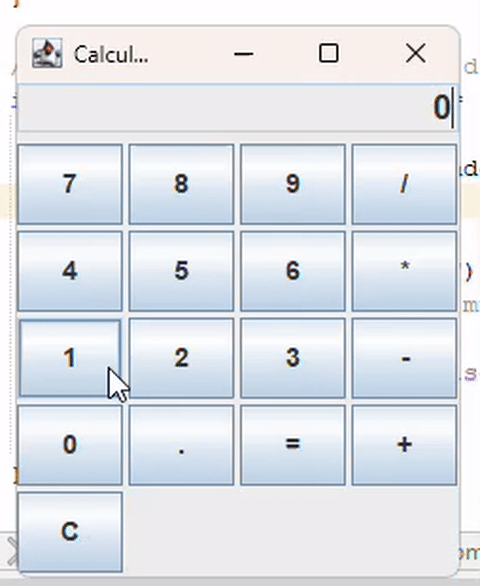

# TP 03 – Calculadora (Java AWT)

**Instituto Federal de Educação, Ciência e Tecnologia de São Paulo – Campus Cubatão**
**Disciplina:** CBTLPR2 (Java) – ADS 471
**Professor:** Wellington Tuler Moraes

**Dupla:**
- Brandon Oliveira Simões
- Eriel de Jesus Souza

---

# Enunciado
Programa em Java que implementa uma calculadora com interface gráfica, usando apenas a biblioteca AWT. A calculadora permite realizar as operações de adição, subtração, multiplicação e divisão, com tratamento de erros via try, catch e finally.

## Programa em Funcionamento
Abaixo está o GIF demonstrando a execução do programa:

