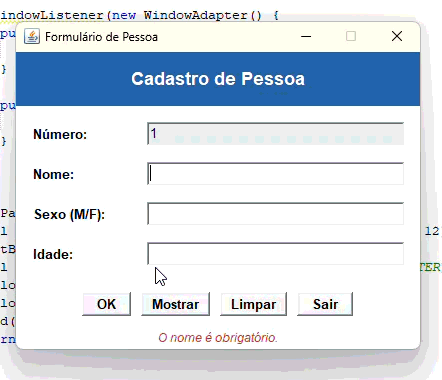

# TP 03 – Cadastro de Pessoa (v1)

**Instituto Federal de Educação, Ciência e Tecnologia de São Paulo – Campus Cubatão**
**Disciplina:** CBTLPR2 (Java) – ADS 471
**Professor:** Wellington Tuler Moraes

**Dupla:**
- Brandon Oliveira Simões
- Eriel de Jesus Souza


## Programa em Funcionamento
Abaixo está o GIF demonstrando a execução do programa:



## Descrição

Programa em Java que permite cadastrar uma pessoa por meio de um formulário gráfico, usando apenas a biblioteca **AWT**. Os dados digitados são transferidos para um objeto `umaPessoa`, instância da classe `Pessoa`, e podem ser exibidos em uma lista na própria janela.

## Estrutura do projeto

```
tp.pkg03
├── Pessoa.java        Classe de modelo
├── FormPessoa.java    Formulário gráfico (Frame AWT)
└── (classe main)      Classe que instancia e exibe o FormPessoa
```

### Classe `Pessoa`

| Membro | Tipo | Descrição |
|---|---|---|
| `kp` | `protected static int` | Contador de pessoas cadastradas |
| `nome` | `protected String` | Nome da pessoa |
| `sexo` | `protected char` | Sexo (`M` ou `F`) |
| `idade` | `protected int` | Idade |

**Construtores:** `Pessoa()` e `Pessoa(String, char, int)`.
**Métodos:** `setKp()`, `setNome(String)`, `setSexo(char)`, `setIdade(int)`, `getKp()`, `getNome()`, `getSexo()` e `getIdade()`.

O contador `kp` é estático e incrementado por `setKp()`, que é chamado dentro do construtor com parâmetros. Assim ele indica quantas pessoas distintas já foram "setadas".

### Classe `FormPessoa`

Estende `Frame` e implementa `ActionListener`. Contém:

- **Número:** campo somente leitura, sem foco. Mostra o número da pessoa que está sendo cadastrada (`kp + 1`).
- **Nome:** campo de texto, obrigatório.
- **Sexo:** lista de seleção (`Choice`) com as opções `M` e `F`, obrigatório. Como só oferece esses dois valores, o campo não aceita outra entrada.
- **Idade:** campo de texto, obrigatório, aceita somente número inteiro.
- **Botão OK:** valida os campos e transfere os dados para o objeto `umaPessoa`.
- **Botão Mostrar:** descarrega os dados de `umaPessoa`, incluindo o contador `kp`, em um componente `List` em uma segunda tela.
- **Botão Voltar:** retorna ao formulário para continuar o cadastro.

## Funcionamento

1. Ao abrir, o foco inicia no campo **Nome** e o campo **Número** exibe `1`.
2. O usuário preenche Nome, Sexo e Idade e clica em **OK**.
3. Se algum campo for inválido ou estiver vazio, uma mensagem de erro (em vermelho) aparece na parte inferior da janela.
4. Se estiver tudo correto, o objeto `umaPessoa` é criado, o `kp` é incrementado, o formulário é limpo e o campo **Número** passa a mostrar o próximo número.
5. Ao clicar em **Mostrar**, a janela exibe uma lista com o contador `kp`, o nome, o sexo e a idade de `umaPessoa`.
6. O botão **Voltar** retorna à tela de cadastro.

## Validações

- Nome, Sexo e Idade são de preenchimento obrigatório.
- Sexo só aceita `M` ou `F`.
- Idade deve ser um número inteiro.
- O campo Número não pode ser editado.

## Técnicas de interface (AWT)

- `BorderLayout` para dividir a janela em cabeçalho, conteúdo e mensagem de status.
- `GridBagLayout` para alinhar rótulos e campos do formulário.
- `CardLayout` para alternar entre a tela de cadastro e a tela da lista.
- `FlowLayout` para organizar os botões.
- Mensagens de erro e de sucesso exibidas na própria janela, com cores diferentes.


