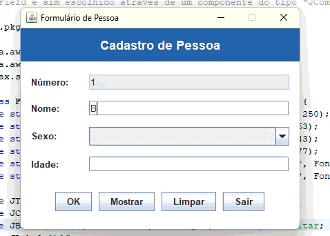

# TP 03 – Cadastro de Pessoa (v2)

**Instituto Federal de Educação, Ciência e Tecnologia de São Paulo – Campus Cubatão**
**Disciplina:** CBTLPR2 (Java) – ADS 471
**Professor:** Wellington Tuler Moraes

**Dupla:**
- Brandon Oliveira Simões
- Eriel de Jesus Souza

# Enunciado
Refaça o exercício anterior, porém agora o sexo não deve ser digitado através de  um TextField e sim escolhido através de um componente do tipo “JComboBox”. 

## Programa em Funcionamento
Abaixo está o GIF demonstrando a execução do programa:

