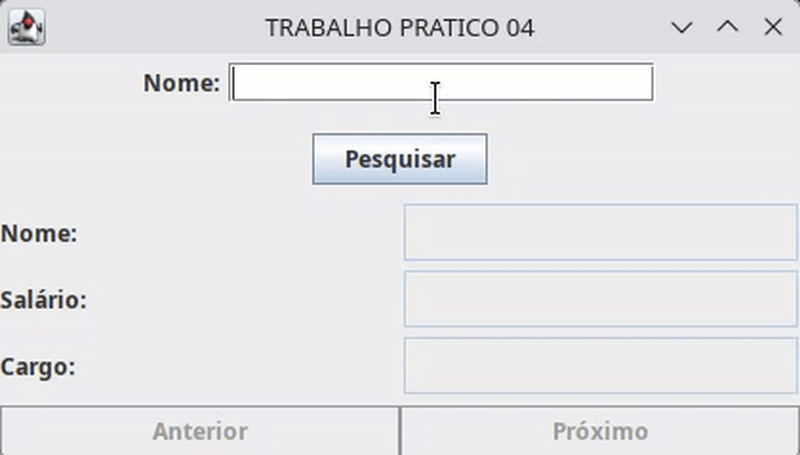

# Trabalho Prático 04 – Java + JDBC + SQL Server

**Matéria:** Linguagem de Programação 2 (CBTLPR2) – ADS 471
**Professor:** Wellington Tuler Moraes
**Dupla:** Brandon Oliveira e Eriel de Souza
**Instituição:** IFSP – Campus Cubatão

## Descrição
Aplicação Java (Swing) que pesquisa funcionários por nome (usando `LIKE`) em um banco
SQL Server chamado `aulajava` e permite navegar pelos resultados com os botões
**Anterior** e **Próximo**, exibindo nome, salário e cargo.

## Demonstração

## Estrutura
| Arquivo | Função |
|---|---|
| `banco.sql` | Cria o banco `aulajava`, as tabelas `tbcargos` e `tbfuncs` e insere registros |
| `Conexao.java` | Conexão JDBC com o SQL Server |
| `TelaPesquisa.java` | Tela (frame), pesquisa com `PreparedStatement` e navegação pelo `ResultSet` |

## Modelo do banco
- `tbcargos (cod_cargo SMALLINT PK, ds_cargo CHAR(20))`
- `tbfuncs (cod_func DECIMAL(9) PK, nome_func CHAR(30), sal_func MONEY, cod_cargo SMALLINT FK → tbcargos)`
