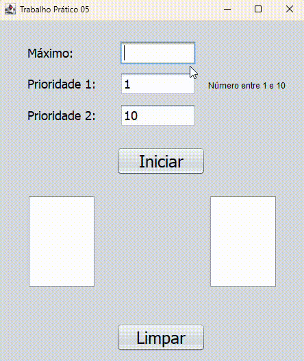

# Trabalho Prático 5 – Threads em Java

**Instituto Federal de Educação, Ciência e Tecnologia de São Paulo – Campus Cubatão**
**Disciplina:** Linguagem de Programação 2 (Java) – ADS 471
**Professor:** Wellington Tuler Moraes
**Autores:** Brandon Oliveira e Eriel de Jesus Souza

---

## Enunciado

**LP2I4 (Java) – Prof. Wellington – Trabalho prático 5.**

1. Elabore um programa em Java com as seguintes características:

   - Utilizando os conceitos de Thread apresentados na última aula, elabore o formulário abaixo, utilizando a ferramenta NetBeans:

     Formulário "Trabalho Prático 5", com os campos *Máximo* (1000), *Prioridade 1* (1) e *Prioridade 2* (10), a indicação "Número entre 1 e 10", o botão **Iniciar**, duas listas (com os valores 994 a 999 visíveis ao final), o texto "Final" abaixo de cada lista e o botão **Limpar**.

**Onde:**

- `jTextField` valor máximo conterá o valor máximo que o laço de contagem das Threads deverão atingir.
- Prioridades 1 e 2 são os valores de prioridade da Thread, sendo um número entre 1 e 10, ou então uma combo com opções de prioridades mínima, média e máxima.
- Labels Fim1 e Fim2 só devem aparecer ao final da contagem das listas.
- Os campos 1 e 2 são listas e devem ser preenchidas com os valores dos laços das threads.

**OBS:**

- Utilize Novo Projeto (Aplicativo Java) [Não crie uma classe principal].
- Crie um arquivo JFrame principal e um novo Painel que estenderá Runnable.

---

## Teste do programa

---

## Estrutura do projeto

Projeto criado no NetBeans como **Java Application**, sem classe principal separada. Pacote `tp05`:

| Arquivo | Descrição |
| --- | --- |
| `TrabalhoPratico5.java` | JFrame principal, com os campos Máximo, Prioridade 1 e Prioridade 2, os botões Iniciar e Limpar e os dois painéis de contagem. |
| `PainelContagem.java` | Painel (`JPanel`) que implementa `Runnable`, com a lista, o label "Final" e o laço de contagem executado em uma `Thread`. |

